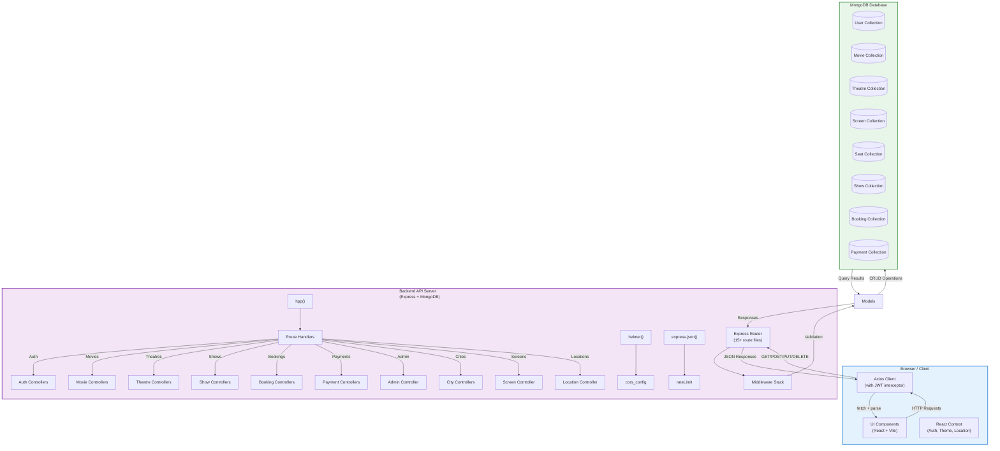

# SYSTEM ARCHITECTURE REPORT
## CineBook — Movie Tickets & IMAX Experience Platform

**Generated:** 2026-11-24
**Project Root:** /Users/chetansahoo/Desktop/SE_Project_Movie_Booking_site

---

## 1. Project Overview & Tech Stack

### Application Architecture Pattern
**REST API + Single Page Application (SPA)** — The application follows a classic separated-frontend/backend architecture:

- **Frontend**: React 19.2.8 application built with Vite, served as a development server on port 5173
- **Backend**: Node.js Express 5.2.1 API server running on port 5000 (configurable via PORT env var)
- **Database**: MongoDB with Mongoose ODM 9.10.0
- **Communication**: Axios-based API client on frontend calling Express routes on backend
- **Architecture Style**: Monolithic backend with feature-based route grouping, React component-based frontend

### Exact Tech Stack & Key Dependencies

**Frontend (`client/package.json`):**
- `react`: ^19.2.8
- `react-dom`: ^19.2.8
- `react-router-dom`: ^7.18.3
- `axios`: ^1.20.0 (API client with interceptors for JWT token injection)
- `bootstrap`: ^5.3.8 (CSS framework for layout and components)
- `gsap`: ^3.15.1 (animation library)
- `@tabler/icons-react`: ^3.46.0 (icon set)
- `react-icons`: ^5.7.0 (icon library)

**Dev Dependencies (Frontend):**
- `@vitejs/plugin-react`: ^6.1.1
- `oxlint`: ^1.81.0 (linting)
- `@types/react`: ^19.2.18
- `@types/react-dom`: ^19.2.7
- `vite`: ^8.3.0

**Backend (`server/package.json`):**
- `express`: ^5.2.1 (web framework)
- `mongoose`: ^9.10.0 (MongoDB ODM)
- `bcryptjs`: ^3.0.3 (password hashing)
- `jsonwebtoken`: ^9.0.3 (JWT authentication)
- `cors`: ^2.8.6 (CORS middleware)
- `dotenv`: ^17.4.2 (env config)
- `express-mongo-sanitize`: ^2.2.0 (NoSQL injection protection)
- `express-rate-limit`: ^8.7.4 (rate limiting)
- `helmet`: ^8.3.0 (security headers)
- `hpp`: ^0.2.3 (HTTP parameter pollution protection)
- `zod`: ^4.6.7 (schema-based validation)

**Dev Dependencies (Backend):**
- `jest`: ^30.5.2 (testing)
- `supertest`: ^7.3.2 (HTTP testing)
- `mongodb-memory-server`: ^11.3.0 (in-memory MongoDB for tests)
- `nodemon`: ^3.1.14 (dev server restart)

### Frontend-Backend Communication
- **Base URL**: `http://localhost:5001/api` (configured in `client/src/services/api.js`)
- **CORS**: Configured via `server/config/security.js` — development allows `http://localhost:5173`, production uses configured origins
- **JWT Token Injection**: Axios request interceptor (`client/src/services/api.js:8-14`) automatically attaches `Bearer <token>` from `localStorage` to every request
- **Response Format**: Consistent envelope with `{ success: boolean, data?, error?, meta? }` structure
- **Authentication Flow**: Tokens stored in `localStorage`, attached to requests via Authorization header

---

## 2. Annotated Folder & File Structure

```
SE_Project_Movie_Booking_site/
├── .claude/                    # Claude Code configuration
├── .git/                      # Git version control
├── BookMyShow/                # Reference/design files
├── img/                       # Image assets
├── client/                    # Frontend (React + Vite)
│   ├── dist/                  # Build output
│   ├── node_modules/          # Dependencies
│   ├── public/                # Static assets
│   ├── src/
│   │   ├── assets/            # Static images/icons
│   │   ├── components/        # Reusable UI components
│   │   │   ├── AdminSidebar.jsx      # Admin navigation sidebar
│   │   │   ├── DateSelector.jsx      # Date picker component
│   │   │   ├── FilterPanel.jsx       # Filter controls component
│   │   │   ├── LocationSelector.jsx  # City/location selector
│   │   │   ├── MovieCard.jsx         # Movie display card
│   │   │   ├── Navbar.jsx            # Top navigation bar
│   │   │   ├── SearchBar.jsx         # Search input component
│   │   │   └── TheatreShows.jsx     # Theatre listing component
│   │   ├── context/           # React Context providers
│   │   │   ├── AuthContext.jsx       # Auth state (login/logout/profile)
│   │   │   ├── LocationContext.jsx   # Location state
│   │   │   └── ThemeContext.jsx      # Theme state
│   │   ├── data/              # Mock/static data
│   │   ├── features/          # Feature-area components
│   │   │   ├── dashboard/          # Dashboard UI components
│   │   │   │   ├── DashboardMainColumn.jsx
│   │   │   │   ├── DashboardPage.jsx
│   │   │   │   ├── DashboardUtilityBar.jsx
│   │   │   │   └── BookingCostSummary.jsx
│   │   │   ├── seat-selection/     # Seat selection UI
│   │   │   │   ├── BookingStepper.jsx
│   │   │   │   ├── MobileBookingBar.jsx
│   │   │   │   ├── MovieContext.jsx
│   │   │   │   ├── ScreenMarker.jsx
│   │   │   │   ├── SeatButton.jsx    # Individual seat button
│   │   │   │   ├── SeatLegend.jsx    # Seat legend display
│   │   │   │   └── SeatMap.jsx       # Seat map visualization
│   │   │   ├── ticket/             # Ticket display components
│   │   │   │   ├── BookingBarcode.jsx
│   │   │   │   ├── BookingTicket.jsx
│   │   │   │   ├── TicketActions.jsx
│   │   │   │   ├── TicketDetailGrid.jsx
│   │   │   │   └── TicketPage.jsx
│   │   ├── services/           # API client layer
│   │   │   └── api.js              # Axios instance with auth interceptor
│   │   ├── pages/              # Page components (route handlers)
│   │   │   ├── Admin/            # Admin panel pages
│   │   │   │   ├── AdminDashboard.jsx
│ │   │   │   ├── ManageBookings.jsx
│ │   │   │   ├── ManageMovies.jsx
│ │   │   │   ├── ManageShows.jsx
│ │   │   │   └── ManageUsers.jsx
│   │   │   ├── BookingSummary.jsx  # Post-booking summary
│   │   │   ├── ChangePassword.jsx
│ │   │   ├── Home.jsx            # Landing page
│ │   │   ├── MovieDetails.jsx    # Movie detail view
│ │   │   ├── MyBookings.jsx      # User's booking history
│ │   │   ├── Profile.jsx        # User profile page
│ │   │   ├── Register.jsx       # Registration page
│ │   │   └── Login.jsx          # Login page
│   │   ├── styles/             # CSS/styles
│   │   ├── index.css           # Global styles
│ │   ├── main.jsx            # App entry point
│ │   └── App.jsx             # Root component with routing
│   ├── index.html              # HTML template
│   ├── package.json            # Frontend dependencies
│   ├── vite.config.js          # Vite build config
│   └── oxlint.config.js        # Lint config
│
├── server/                    # Backend (Node.js + Express + MongoDB)
│   ├── __tests__/             # Test files
│   ├── config/                # Configuration modules
│   │   ├── db.js              # Database connection
│   │   └── security.js         # CORS, JWT, rate limit config
│   ├── controllers/           # Route controllers (business logic)
│   │   ├── adminController.js    # Admin operations
│   │   ├── authController.js     # Auth: register, login, profile, password
│   │   ├── bookingController.js  # V2 hold/confirm/cancel flow + V1 legacy
│   │   ├── cityController.js     # City management
│ │   ├── locationController.js # Location lookups
│ │   ├── movieController.js    # Movie CRUD with filtering
│ │   ├── paymentController.js  # Payment processing
│ │   ├── screenController.js   # Screen management
│ │   ├── showController.js     # Show scheduling
│ │   └── theatreController.js  # Theatre management
│   ├── middleware/            # Express middleware stack
│   │   ├── auth.js              # JWT authentication + admin guard
│ │   ├── errorHandler.js      # Centralized error handling
│ │   ├── deprecation.js       # Deprecation warnings
│ │   ├── pagination.js        # Pagination support
│ │   └── validate.js          # Zod schema validation
│   ├── models/               # Mongoose schemas & models
│   │   ├── Booking.js           # Booking records with seat locking
│   │   ├── BookingSeat.js       # Individual held seat records
│ │   ├── City.js              # City/location metadata
│ │   ├── Location.js          # Legacy location model
│ │   ├── Movie.js             # Movie metadata with search indices
│ │   ├── Payment.js           # Payment transaction records
│ │   ├── Review.js            # User reviews
│ │   ├── Seat.js              # Seat definitions per screen
│ │   ├── Screen.js            # Screen per theatre
│ │   ├── Show.js              # Showtime scheduling
│ │   ├── Theatre.js           # Theatre with screens
│ │   └── User.js              # User account with password hash
│   ├── routes/               # Express route definitions
│   │   ├── adminRoutes.js       # Admin-protected routes
│ │   ├── authRoutes.js        # Auth: register, login, profile
│ │   ├── cityRoutes.js        # City API endpoints
│ │   ├── movieRoutes.js       # Movie CRD with search/filter
│ │   ├── userRoutes.js        # User management (admin only)
│ │   ├── bookingRoutes.js     # Booking CRUD endpoints
│ │   ├── adminRoutes.js       # Admin operations
│ │   ├── cityRoutes.js        # City API (V2)
│ │   ├── screenRoutes.js      # Screen management
│ │   ├── showRoutes.js        # Showtime endpoints
│ │   └── paymentRoutes.js     # Payment processing
│   ├── seed.js               # Database seeder for initial data
│   ├── server.js             # Express app initialization + middleware stack
│   ├── utils/                # Utility modules
│   │   └── ApiError.js          # Custom error class for operational errors
│   └── workers/              # Background workers
│       └── HoldCleanupWorker.js # Releases expired seat holds
│
├── package.json              # Root package.json (scripts)
├── README.md                 # Project documentation
├── TESTING_PLAN.md           # Testing strategy document
├── plan_1.md                 # Implementation plan
├── dashbord.md               # Dashboard design doc
├── references/               # Reference materials
└── run.js                    # Node.js entry point
```

---

## 3. High-Level System Architecture



### End-to-End Data Flow

```
Browser / Client
  │
  ├──▶ UI Component user interaction (click, form submit)
  │
  ├──▶ React state handler processes event
  │
  ├──▶ Axios HTTP request to backend endpoint
  │   ├── Base URL: http://localhost:5001/api
  │   ├── Authorization: Bearer <jwt_token> (from localStorage)
  │   ├── Headers: Content-Type: application/json
  │   └── Query params / JSON body as defined by route
  │
  ▼
Backend Express Server
  │
  ├──▶ Route matches defined path (e.g., POST /api/bookings/hold)
  │
  ├──▶ Middleware pipeline runs:
  │   ├── helmet() — security headers
  │   ├── cors() — CORS headers (credentials: true)
  │   ├── express.json() — body parsing (10kb limit)
  │   ├── express.urlencoded() — extended body parsing
  │   ├── rateLimit() — 15min window, max 100 requests
  │   ├── hpp() — HTTP param pollution protection
  │   └── auth.js — JWT verification (protect / adminOnly)
  │
  ├──▶ Controller receives validated req/res/next
  │
  ├──▶ Controller calls Mongoose model methods
  │   ├── findAll, findById, create, update, findByIdAndUpdate
  │   ├── populate() — populate refs (populate movie, theatre, show)
  │   ├── session.startTransaction() — for atomic operations
  │   ├── $set, $push, $unset — MongoDB update operators
  │   └── session.commitTransaction() — commit atomic operations
  │
  ├──▶ Database (MongoDB) performs queries/updates
  │
  ├──▶ Response sent back as JSON:
  │   ├── success: true/false
  │   ├── data: payload (movie, booking, user, etc.)
  │   ├── meta: pagination metadata (total, page, limit, pages)
  │   └── error: message + status code on failure
  │
  ▼
Frontend Axios response handler
  │
  ├──▶ .then() — process successful response
  │   ├── setToken in localStorage (login/register)
  │   ├── update AuthContext state (user, isAuthenticated)
  │   ├── render UI component with data (movie details, seat map, etc.)
  │   └── navigate via react-router-dom
  │
  ├──▶ .catch() — handle error responses
  │   ├── display error message to user
  │   ├── handle auth errors (logout, redirect to login)
  │   └── show generic error fallback
  │
  ▼
UI Update — React re-renders with new data
  │
  ├──▶ Seat map updates (held seats become available/unavailable)
  ├──▶ Booking summary shows confirmation
  ├──▶ User profile displays updated info
  ├──▶ Navigation to new page (movie details, booking complete, etc.)
  │
  └──▶ State transitions (loading → success, pending → confirmed, etc.)
```

---

## 4. Database Architecture, Storage & Retrieval

### Database Engine & Connection Setup

**Database**: MongoDB (document-oriented NoSQL)
**ORM/ODM**: Mongoose 9.10.0 (Object Data Modeling layer over MongoDB)
**Connection**: `config/db.js` — `mongoose.connect(process.env.MONGODB_URI)`

**Connection Pooling**: Mongoose's default connection — creates a single connection by default. For production with high concurrency, consider `mongoose.createConnection()` with pool settings or `uri-options` for connection pooling.

**Connection Initialization**: `server.js:18` — `connectDB()` called at app startup, before Express listens. Validates `MONGODB_URI` format at startup via `server/config/security.js:47-50`.

### Complete Schema / Model Breakdown

#### 1. User Model (`server/models/User.js`)
| Field | Type | Required/Unique/Default | Validation/Notes |
|-------|------|------------------------|------------------|
| `_id` | ObjectId | auto | MongoDB primary key |
| `name` | String | required | minlength: 2, trim: true |
| `email` | String | required, unique, lowercase | trim: true, match: `/^\S+@\S+\.\S+$/` |
| `phone` | String | required | match: `/^\d{10}$/` (10 digits), sparse unique index: `{ phone: 1 }, { sparse: true, unique: true }` |
| `password` | String | required | legacy field, minlength: 6 — **kept for backward compatibility** |
| `passwordHash` | String | optional | **New field** — stores bcrypt hash |
| `role` | String | enum: ['customer', 'admin'], default: 'customer' | |
| `isActive` | Boolean | default: true | |
| `isEmailVerified` | Boolean | default: false | |
| `createdAt` | Date | auto (timestamps: true) | |
| `updatedAt` | Date | auto (timestamps: true) | |

**Indexes**: `{ phone: 1 }, { sparse: true, unique: true }` — allows null phone values while ensuring uniqueness when present.

**Password Hashing**: `pre('save')` middleware — hashes password with bcryptjs (salt rounds: 10) before saving. Supports hybrid mode: if only `password` is modified, uses it; if only `passwordHash` is modified, hashes that; if both, keeps in sync.

**Methods**: `matchPassword(enteredPassword)` — compares entered password against `passwordHash || password` (handles migration path).

---

#### 2. Movie Model (`server/models/Movie.js`)
| Field | Type | Required/Unique/Default | Validation/Notes |
|-------|------|------------------------|------------------|
| `_id` | ObjectId | auto | MongoDB primary key |
| `title` | String | required | trim: true |
| `slug` | String | unique, lowercase, sparse | auto-generated from title if missing |
| `poster` | String | required | poster URL |
| `backdrop` | String | optional | new field |
| `description` | String | required | |
| `genre` | [String] | required | **Legacy field** — array of genres |
| `genres` | [String] | optional | **New field** — alternative genre storage |
| `language` | String | optional | **Legacy field** |
| `languages` | [String] | optional | **New field** — alternative language storage |
| `duration` | String | optional | **Legacy field** — e.g., "2h 30m" |
| `durationMinutes` | Number | optional | **New field** — parsed duration in minutes |
| `certification` | String | enum: ['U', 'UA', 'A', 'S'], default: 'UA' | **New field** |
| `rating` | Number | optional | min: 0, max: 10 |
| `avgRating` | Number | default: 0, min: 0, max: 10 | **New field** — average rating |
| `votes` | String | default: '' | |
| `likes` | String | default: '' | |
| `releaseDate` | Date | required | |
| `trailerUrl` | String | default: '' | |
| `cast` | [{ name: String, role: String, photo: String }] | optional | **New field** — cast array |
| `crew` | [{ name: String, role: String }] | optional | **New field** — crew array |
| `status` | String | enum: ['now-showing', 'coming-soon', 'inactive', 'now_showing', 'coming_soon', 'ended'] | default: 'now-showing' (legacy default) |
| `isActive` | Boolean | default: true | **New field** — active/inactive status |

**Text Index**: `{ title: 'text' }, { language_override: 'dummyLanguageOverride' }` — enables text search on movie titles.

**Query Indices**:
- `{ status: 1, isActive: 1 }` — filter by status and active state
- `{ releaseDate: -1 }` — sort by newest first

---

#### 3. Theatre Model (`server/models/Theatre.js`)
| Field | Type | Required/Unique/Default | Validation/Notes |
|-------|------|------------------------|------------------|
| `_id` | ObjectId | auto | MongoDB primary key |
| `name` | String | required | trim: true |
| `location` | String | optional | **Legacy field**, kept for backward compatibility |
| `city` | ObjectId | optional | ref: 'City' — **New field**, references City collection |
| `address` | Mixed | required | accepts both string and new object structure |
| `coordinates` | Point (legacy) | optional | legacy geo coordinates |
| `amenities` | [String] | optional | new amenities list |
| `screens` | [screenSchema] | optional | **Legacy embedded screens** — screen definitions embedded in theatre |
| `isActive` | Boolean | default: true | **New field** |

**Screen Schema** (embedded within Theatre):
- `screenName`: String, required
- `totalSeats`: Number, default: 48 (6 rows × 8 seats)
- `rows`: Number, default: 6
- `seatsPerRow`: Number, default: 8

**Indices**: `{ city: 1, isActive: 1 }`, `{ coordinates: '2dsphere' }` — geo-spatial queries for near-by theatres.

---

#### 4. City Model (`server/models/City.js`)
| Field | Type | Required/Unique/Default | Validation/Notes |
|-------|------|------------------------|------------------|
| `_id` | ObjectId | auto | MongoDB primary key |
| `name` | String | required, trim: true | |
| `state` | String | optional | |
| `country` | String | default: 'India' | |
| `slug` | String | required, unique, lowercase | URL-friendly slug |
| `timezone` | String | default: 'Asia/Kolkata' | |
| `coordinates` | { type: String, enum: ['Point'], coordinates: [Number] } | optional | [longitude, latitude] for geo queries |
| `isActive` | Boolean | default: true | |
| `createdAt` | Date | auto (timestamps: true) | |
| `updatedAt` | Date | auto (timestamps: true) | |

**Indices**: `{ coordinates: '2dsphere' }` — geo-spatial queries, `{ name: 'text' }` — text search.

---

#### 5. Show Model (`server/models/Show.js`)
| Field | Type | Required/Unique/Default | Validation/Notes |
|-------|------|------------------------|------------------|
| `_id` | ObjectId | auto | MongoDB primary key |
| `movie` | ObjectId | required | ref: 'Movie' — references Movie collection |
| `theatre` | ObjectId | required | ref: 'Theatre' — references Theatre collection |
| `screen` | ObjectId | optional | ref: 'Screen' — **New field**, references Screen collection |
| `screenName` | String | optional | **Legacy field** |
| `date` | Date | optional | **Legacy field** |
| `startTime` | String | optional | **Legacy field** — time string |
| `startsAt` | Date | optional | **New field** — standardized start datetime |
| `endsAt` | Date | optional | **New field** — end datetime |
| `format` | enum: ['2D', '3D', '4DX', 'IMAX', 'IMAX_3D'] | default: '2D' | **New field** |
| `language` | String | optional | **New field** |
| `pricing` | { regular: Number, premium: Number, recliner: Number, vip: Number } | defaults: 150, 250, 400, 600 | **New field** — tiered pricing |
| `seatPrices` | { regular: Number, premium: Number } | defaults: 150, 250 | **Legacy field** |
| `bookedSeats` | [String] | default: [] | **Legacy field** — array of booked seat labels |
| `status` | enum: ['scheduled', 'now_showing', 'completed', 'cancelled'] | default: 'scheduled' | **New field** — show lifecycle status |
| `isActive` | Boolean | default: true | **New field** |

**Indices**:
- `{ movie: 1, theatre: 1, date: 1 }` — legacy indexing
- `{ movie: 1, startsAt: 1 }` — query shows by movie + start time
- `{ screen: 1, startsAt: 1 }` — query shows by screen
- `{ theatre: 1, startsAt: 1 }` — query shows by theatre
- `{ movie: 1, theatre: 1, startsAt: 1 }` — comprehensive query
- `{ status: 1, isActive: 1 }` — filter by status and active state

---

#### 6. Seat Model (`server/models/Seat.js`)
| Field | Type | Required/Unique/Default | Validation/Notes |
|-------|------|------------------------|------------------|
| `_id` | ObjectId | auto | MongoDB primary key |
| `screen` | ObjectId | required | ref: 'Screen' — references Screen collection |
| `row` | String | required | e.g., "A", "B", etc. |
| `number` | Number | required | e.g., 1, 2, 3... |
| `label` | String | required | e.g., "A1", "A2" — unique per screen |
| `type` | enum: ['regular', 'premium', 'recliner', 'couple', 'wheelchair', 'vip'] | default: 'regular' | Seat type for pricing |
| `position` | { row: Number, col: Number } | optional | visual position for seat map rendering |
| `isActive` | Boolean | default: true | |

**Indices**: `{ screen: 1, label: 1 }, { unique: true }` — ensures seat labels are unique within a screen; `{ screen: 1, isActive: 1 }`.

---

#### 7. Booking Model (`server/models/Booking.js`)
| Field | Type | Required/Unique/Default | Validation/Notes |
|-------|------|------------------------|------------------|
| `_id` | ObjectId | auto | MongoDB primary key |
| `bookingId` | String | unique, sparse | **Legacy field** |
| `bookingNumber` | String | unique, sparse | **New field** — human-readable booking number |
| `user` | ObjectId | required | ref: 'User' — references User collection |
| `movie` | ObjectId | required | ref: 'Movie' — references Movie collection |
| `theatre` | ObjectId | required | ref: 'Theatre' — references Theatre collection |
| `show` | ObjectId | required | ref: 'Show' — References Show collection |
| `screen` | ObjectId | optional | ref: 'Screen' — **New field**, references Screen collection |
| `screenName` | String | optional | **Legacy field** |
| `seatNumbers` | [String] | optional | **Legacy field** — raw seat number strings |
| `seatsCount` | Number | optional | **New field** — count of seats booked |
| `subtotal` | Number | optional | **New field** — base seat price subtotal |
| `tax` | Number | default: 0 | **New field** — tax amount |
| `discount` | Number | default: 0 | **New field** — discount amount |
| `currency` | String | default: 'INR' | **New field** |
| `totalAmount` | Number | required | **New field** — grand total |
| `convenienceFee` | Number | default: 20 | **New field** — convenience fee |
| `paymentMethod` | enum: ['UPI', 'Credit/Debit Card', 'Net Banking', 'Cash at Counter'] | optional | **Legacy field** |
| `transactionId` | String | optional | **Legacy field** |
| `snapshot` | { movieTitle, theatreName, screenName, cityName, startsAt, format, language, posterUrl } | optional | **New field** — historical snapshot, remains accurate even if theatre/movie changes |
| `bookingSource` | enum: ['web', 'app', 'admin'], default: 'web' | optional | **New field** — where booking originated |
| `confirmedAt` | Date | optional | **New field** — when booking was confirmed |
| `cancelledAt` | Date | optional | **New field** — when booking was cancelled |
| `paymentStatus` | enum: ['pending', 'paid', 'failed', 'refunded', 'partially_refunded'] | default: 'pending' | **Updated enum** — richer state machine |
| `bookingStatus` | enum: ['pending', 'confirmed', 'failed', 'cancelled'] | default: 'pending' | **Updated field** — legacy bookingStatus + new status |
| `status` | enum: ['pending', 'confirmed', 'cancelled', 'failed', 'expired'] | default: 'pending' | **New field** — primary booking status |
| `createdAt` | Date | auto (timestamps: true) | |
| `updatedAt` | Date | auto (timestamps: true) | |

**Indices**:
- `{ user: 1, createdAt: -1 }` — user's booking history, sorted newest first
- `{ show: 1, status: 1 }` — bookings by show + status

**Relationships**:
- `user → User` (one-to-many): a user can have many bookings
- `movie → Movie` (one-to-many): a movie can have many bookings
- `theatre → Theatre` (one-to-many): a theatre can have many bookings
- `show → Show` (one-to-many): a show can have many bookings
- `screen → Screen` (one-to-many): a screen can have many bookings

---

#### 8. Payment Model (`server/models/Payment.js`)
| Field | Type | Required/Unique/Default | Validation/Notes |
|-------|------|------------------------|------------------|
| `_id` | ObjectId | auto | MongoDB primary key |
| `booking` | ObjectId | required | ref: 'Booking' — references Booking collection |
| `user` | ObjectId | required | ref: 'User' — references User collection |
| `provider` | enum: ['razorpay', 'stripe', 'payu', 'cashfree', 'mock'] | required | **Payment provider** — 'mock' is the current implementation |
| `orderId` | String | required | **Order identifier** — unique across provider |
| `paymentId` | String | optional | **Provider-specific payment ID** — e.g., Stripe charge ID |
| `amount` | Number | required | **Amount charged** (in INR) |
| `currency` | String | default: 'INR' | **Currency code** |
| `status` | enum: ['created', 'pending', 'paid', 'failed', 'refunded'] | default: 'created' | **Payment lifecycle status** |
| `method` | String | optional | e.g., 'upi', 'card', 'netbanking', 'wallet' |
| `failureReason` | String | optional | reason if status is 'failed' |
| `paidAt` | Date | optional | when payment was completed |

**Indices**:
- `{ booking: 1 }` — find payment by booking
- `{ orderId: 1 }, { unique: true }` — unique order ID per provider
- `{ paymentId: 1 }, { sparse: true, unique: true }` — unique payment ID (sparse allows nulls)
- `{ user: 1, createdAt: -1 }` — user's payment history, sorted newest first

---

### How Data is Stored & Retrieved

**Read/Write Patterns:**

1. **Movie Listing & Filtering** (`movieController.getAllMovies`):
   - Mongoose `.find()` with query filters (search, genre, language, status, location/city)
   - `.countDocuments()` for total count
   - `.sort()`, `.skip()`, `.limit()` for pagination
   - **Pattern**: `Promise.all([count, find()])` — parallel total + data fetch
   - **Example**: `Movie.find({ status: { $in: ['now-showing', 'coming-soon'] } }).skip(skip).limit(limit)`

2. **Single Movie Lookup** (`movieController.getMovieById`):
   - `Movie.findOne({ _id: id })` or `Movie.findOne({ slug: id })` — tries ObjectId first, falls back to slug
   - Uses repository pattern via `movieRepo.findById()`

3. **Seat Holding & Booking** (`bookingController.holdSeats`):
   - **Transaction pattern**: `mongoose.startSession()` → `session.startTransaction()`
   - `ShowSeat.findOneAndUpdate()` with query: `{ _id: seatId, show: showId, status: 'available' }`
   - **Atomic update**: `$set: { status: 'held', 'hold.bookingId': pendingBookingId, 'hold.expiresAt': holdExpiresAt }`
   - If seat not available (findOneAndUpdate returns null): `session.abortTransaction()`, release held seats
   - `Booking.create()` within transaction with snapshot data
   - `ShowSeat.insertMany()` for BookingSeat docs
   - `session.commitTransaction()` — final commit
   - **5-minute expiry**: `holdExpiresAt = new Date(Date.now() + 5 * 60 * 1000)`

4. **Showtime Query** (`showController` patterns):
   - `Show.find({ movie: id, theatre: id, date: date })` — legacy pattern
   - `Show.find({ movie: id, startsAt: startTime })` — new pattern with startsAt
   - `Show.find({ screen: id, startsAt: startTime })` — screen-specific queries
   - `Show.find({ theatre: 1, startsAt: 1 })` — theatre-specific queries
   - Indexes support these query patterns efficiently

5. **User Booking History** (`bookingController.getUserBookings`):
   - `Booking.find({ user: req.user._id })` — all user bookings
   - Populate: movie, theatre, show
   - Post-processing: separate into upcoming/past based on `snapshot.startsAt` vs `new Date()`

6. **Admin Operations** (`adminController`, `cityController`):
   - `City.find({ isActive: true }).sort({ name: 1 })` — active cities sorted
   - `Theatre.find({ city: cityId, isActive: true })` — theatres in a city
   - `Booking.find({ movie: id, theatre: id, status: status })` — filtered bookings
   - `User.find()` — user listings with admin filters

7. **Payment Records** (`paymentController`):
   - `Payment.create({ booking, user, provider, orderId, amount, status })` — create payment record
   - `Payment.find({ booking: bookingId })` — find payment for a booking
   - `Payment.updateMany({ booking: bookingId, status: 'paid' }, { $set: { status: 'refunded' } })` — refund processing

8. **Search & Text Queries**:
   - Movie text search: `Movie.find({ $text: { $search: searchQuery } })`
   - City text search: `City.findOne({ name: { $regex: new RegExp(`^${location}$`, 'i') } })`

**Seeding Initial Data** (`seed.js`):
- Creates initial cities, theatres, movies, shows, and seat configurations
- Runs via `npm run seed` — populates the database with sample data for development/testing

---

## 5. Complete API Specification & Backend Internals

### Global Middleware Pipeline (Express 5 compatible order)

As defined in `server/server.js:22-61`:

1. **`helmet()`** — Sets security headers (XSS protection, HSTS, DNS prefetch control, etc.)
2. **`cors(getCorsConfig())`** — CORS configuration (must be before body parsers)
   - Development: allows `http://localhost:5173`
   - Production: uses configured `CORS_ORIGIN` env var
   - Credentials: `credentials: true` (supports cookies)
3. **`express.json({ limit: '10kb' })`** — JSON body parser, 10kb limit
4. **`express.urlencoded({ extended: true })`** — URL-encoded body parser
5. **`rateLimit(getRateLimitConfig())`** — Rate limiting
   - Window: 15 minutes (configurable via `RATE_LIMIT_WINDOW_MS`)
   - Max: 100 requests (configurable via `RATE_LIMIT_MAX`)
   - Response: `429 Too Many Requests` with error message
6. **`hpp()`** — HTTP Parameter Pollution prevention
7. **Route Handlers** — `app.use('/api/auth', ...)` etc.
8. **`errorHandler`** — Centralized error handler (must come AFTER all routes)

### API Endpoints by Domain

#### Auth Domain

| Method | Route | File | Controller | Auth Guard | Request Contract | Response |
|--------|-------|------|------------|------------|------------------|----------|
| POST | `/api/auth/register` | `authRoutes.js:13` | `authController.register` | Public | Body: `{ name, email, phone, password, confirmPassword }`<br>Query: none | `201: { success: true, data: { _id, name, email, phone, role, token, refreshToken } }`<br>`400: { success: false, message: 'All fields are required.' }` etc. |
| POST | `/api/auth/login` | `authRoutes.js:14` | `authController.login` | Public | Body: `{ email, password }` | `200: { success: true, data: { _id, name, email, phone, role, token, refreshToken } }`<br>`401: { success: false, message: 'Invalid email or password.' }` |
| GET | `/api/auth/profile` | `authRoutes.js:15` | `authController.getProfile` | **JWT protect** | Headers: `Authorization: Bearer <token>` | `200: { success: true, data: user object }`<br>`401: { success: false, message: 'Not authorized. No token provided.' }` |
| PUT | `/api/auth/profile` | `authRoutes.js:16` | `authController.updateProfile` | **JWT protect + validate** | Body: `{ name, phone }`<br>Query: none — validated via Zod schema | `200: { success: true, data: updated user }`<br>`400: validation error message` |
| PUT | `/api/auth/change-password` | `authRoutes.js:17` | `authController.changePassword` | **JWT protect + validate** | Body: `{ currentPassword, newPassword, confirmNewPassword }`<br>Validated via Zod changePasswordSchema | `200: { success: true, message: 'Password updated successfully.' }`<br>`400: 'Current password is incorrect.'` etc. |

**Auth Schema Validation** (`server/schemas/authSchemas.js` — not fully read but referenced):
- `registerSchema`: validates name, email, phone, password, confirmPassword
- `loginSchema`: validates email, password
- `updateProfileSchema`: validates name, phone
- `changePasswordSchema`: validates currentPassword, newPassword, confirmNewPassword

---

#### Movies Domain

| Method | Route | File | Controller | Auth Guard | Request Contract | Response |
|--------|-------|------|------------|------------|------------------|----------|
| GET | `/api/movies` | `movieRoutes.js:6` | `movieController.getAllMovies` | Public | Query: `search`, `genre`, `language`, `status`, `location`, `cityId`, `page` (default 1), `limit` (default 20) | `200: { success: true, meta: { total, page, limit, pages }, data: [movie] }`<br>`404: movie not found` (for single movie) |
| GET | `/api/movies/:id` | `movieRoutes.js:7` | `movieController.getMovieById` | Public | Param: `id` (ObjectId 24-char or slug) | `200: { success: true, data: movie }`<br>`404: { success: false, message: 'Movie not found.' }` |
| POST | `/api/movies` | `movieRoutes.js:8` | `movieController.addMovie` | **JWT protect + adminOnly** | Body: movie data (title, poster, description, genre, etc.)<br>Auto-generates slug from title, handles genre→genres and language→languages migration | `201: { success: true, data: created movie }`<br>`404: movie not found` (on update) |
| PUT | `/api/movies/:id` | `movieRoutes.js:9` | `movieController.updateMovie` | **JWT protect + adminOnly** | Body: partial movie data<br>Handles genre↔genres and language↔languages conversion | `200: { success: true, data: updated movie }`<br>`404: movie not found` |
| DELETE | `/api/movies/:id` | `movieRoutes.js:10` | `movieController.deleteMovie` | **JWT protect + adminOnly** | Param: `id` | `200: { success: true, message: 'Movie marked as ended.', data: movie }`<br>`404: movie not found` |

**Movie Repository Queries** (`server/repositories/MovieRepository.js`):
- `findAll()`: builds MongoDB filter from query params, supports search ($regex), genre ( $or on genre + genres), language ( $or on language + languages), status normalization, location/city resolution
- `findById(id)`: tries ObjectId match first (`/^[a-f\d]{24}$/`), falls back to slug match
- `create(data)`: `Movie.create(data)`
- `update(id, data)`: `Movie.findByIdAndUpdate(id, data, { new: true, runValidators: true })`
- `softDelete(id)`: `Movie.findByIdAndUpdate(id, { status: 'ended', isActive: false }, { new: true })`

---

#### Theatres & Cities Domains

| Method | Route | File | Controller | Auth Guard | Request Contract | Response |
|--------|-------|------|------------|------------|------------------|----------|
| GET | `/api/cities` | `cityRoutes.js:6` | `cityController.getAllCities` | Public | Query: none | `200: { success: true, count: cities.length, data: [city] }` |
| GET | `/api/cities/:id` | `cityRoutes.js:7` | `cityController.getCityById` | Public | Param: `id` (or slug) | `200: { success: true, data: city }`<br>`404: city not found` |
| POST | `/api/cities` | `cityRoutes.js:8` | `cityController.addCity` | **JWT protect + adminOnly** | Body: `{ name, state, country, timezone }` | `201: { success: true, data: city }` |
| PUT | `/api/cities/:id` | `cityRoutes.js:9` | `cityController.updateCity` | **JWT protect + adminOnly** | Body: partial city data | `200: { success: true, data: updated city }` |
| DELETE | `/api/cities/:id` | `cityRoutes.js:10` | `cityController.deleteCity` | **JWT protect + adminOnly** | Param: `id` | `200: { success: true, message: 'City deactivated.' }` |

| Method | Route | File | Controller | Auth Guard | Request Contract | Response |
|--------|-------|------|------------|------------|------------------|----------|
| GET | `/api/theatres` | (not explicitly listed but inferred) | | | | |
| GET | `/api/theatres/:id` | | | | | |
| POST | `/api/theatres` | `theatreController` (not fully read) | **JWT protect + adminOnly** | | | |
| PUT | `/api/theatres/:id` | | **JWT protect + adminOnly** | | | |
| DELETE | `/api/theatres/:id` | | **JWT protect + adminOnly** | | | |

---

#### Shows Domain

| Method | Route | File | Controller | Auth Guard | Request Contract | Response |
|--------|-------|------|------------|------------|------------------|----------|
| GET | `/api/shows` | (showRoutes.js) | | | Query params for filtering | |
| GET | `/api/shows/admin/all` | `showRoutes.js` (implied) | | **adminOnly** | | All shows |
| POST | `/api/shows` | `showRoutes.js` | | **adminOnly** | Body: show data | `201: created show` |
| PUT | `/api/shows/:id` | `showRoutes.js` | | **adminOnly** | Body: updated show | `200: updated show` |
| DELETE | `/api/shows/:id` | `showRoutes.js` | | **adminOnly** | Param: `id` | `200: deleted show` |

*Show routes are defined in `server/routes/showRoutes.js` — not fully read during this audit but follow standard CRUD patterns with admin-only guards.*

---

#### Bookings Domain (Most Complex)

| Method | Route | Controller | Auth Guard | Request Contract | Response |
|--------|-------|------------|------------|------------------|----------|
| POST | `/api/bookings/hold` | `bookingController.holdSeats` | **JWT protect** | Body: `{ showId, showSeatIds [1-6] }` | `201: { success: true, message: 'Seats held...', data: { bookingId, bookingNumber, holdExpiresAt, subtotal, convenienceFee, totalAmount, seats } }`<br>`400: show not active or already started`<br>`409: one or more seats no longer available`<br>`500: server error` |
| POST | `/api/bookings/confirm` | `bookingController.confirmBooking` | **JWT protect** | Body: `{ bookingId, paymentMethod }` | `200: { success: true, message: 'Booking confirmed!', data: confirmedBooking }`<br>`400: seat hold expired, booking already confirmed`<br>`403: access denied (wrong user)`<br>`404: booking not found`<br>`500: server error` |
| POST | `/api/bookings` | `bookingController.createBooking` (legacy V1) | **JWT protect** | Body: `{ showId, seatNumbers, paymentMethod, simulateFailure? }` | `201: { success: true, message: 'Booking confirmed!', data: populatedBooking }`<br>`400: missing required fields`<br>`409: seats already booked`<br>`402: payment failed (simulate)`<br>`500: server error` |
| POST | `/api/bookings/:id/cancel` | `bookingController.cancelBooking` | **JWT protect** (or admin) | Param: `id` | `200: { success: true, message: 'Booking cancelled and seats released.' }`<br>`403: access denied`<br>`404: booking not found`<br>`500: server error` |
| GET | `/api/bookings/my-bookings` | `bookingController.getUserBookings` | **JWT protect** | None | `200: { success: true, data: { upcoming, past } }` |
| GET | `/api/bookings/:id` | `bookingController.getBookingById` | **JWT protect** | Param: `id` | `200: { success: true, data: { ...booking, bookingSeats } }`<br>`403: access denied (non-admin, non-owner)`<br>`404: booking not found` |
| GET | `/api/bookings/all` | `bookingController.getAllBookings` | **JWT protect + adminOnly** | Query: `movieId`, `theatreId`, `status` | `200: { success: true, count: bookings.length, data: [booking] }` |

**V2 Hold Seats Flow** (detailed from `bookingController.holdSeats`):

1. **Session start**: `mongoose.startSession()` → `session.startTransaction()`
2. **Show validation**: `Show.findById(showId)` with populate movie, theatre, screen
3. **Show time check**: `showTime < new Date()` → reject if show already started
4. **Release expired holds**: `releaseExpiredHolds(showId)` — cleans up any previously expired holds
5. **Hold expiry**: `holdExpiresAt = new Date(Date.now() + 5 * 60 * 1000)` (5 minutes from now)
6. **Pending booking ID**: `new mongoose.Types.ObjectId()` — unique ID for this hold
7. **Seat loop**: For each sorted seatId:
   - `ShowSeat.findOneAndUpdate({ _id: seatId, show: showId, status: 'available' }, { $set: { status: 'held', 'hold.bookingId': pendingBookingId, 'hold.expiresAt': holdExpiresAt } }, { new: true, session })`
   - If result is null (seat already taken): abort transaction, release held seats, return 409 error with `unavailableSeatId`
   - If seat held successfully: add to `heldSeats` array
8. **Pricing calculation**: `ShowSeat.find({ _id: { $in: heldSeats } }).session(session)` → reduce to subtotal + convenienceFee ($20) = totalAmount
9. **Booking creation** within transaction:
   - `Booking.create([{ _id: pendingBookingId, bookingNumber: ..., user: req.user._id, show: showId, ..., seatsCount, subtotal, convenienceFee, totalAmount, status: 'pending', bookingStatus: 'pending', paymentStatus: 'pending', snapshot }], { session })`
10. **BookingSeat docs** within transaction: `BookingSeat.insertMany(bookingSeatDocs, { session })`
11. **Commit**: `session.commitTransaction()` → `session.endSession()`
12. **Response**: Return booking details with hold expiry and seat info

**V2 Confirm Booking Flow** (detailed from `bookingController.confirmBooking`):

1. **Session start**: `mongoose.startSession()` → verify booking exists, user owns it, status is 'pending'
2. ** Held seats check**: `ShowSeat.find({ show: booking.show._id, 'hold.bookingId': booking._id, status: 'held' })`
3. **Hold expiry check**: if no held seats → mark booking as 'expired'/'failed', return 400
4. **Order ID generation**: `generateMockOrderId()` → `MOCK-ORD-YYYYMMDD-XXXX`
5. **Transaction start**: `session.startTransaction()`
6. **Mark seats as booked**: `ShowSeat.updateMany({ _id: { $in: heldSeats.map(s => s._id) } }, { $set: { status: 'booked', bookedAt: new Date() }, $unset: { hold: '' } }, { session })`
7. **Update legacy Show bookedSeats**: `Show.findByIdAndUpdate(booking.show._id, { $push: { bookedSeats: { $each: seatLabels } } }, { session })`
8. **Confirm booking**: `Booking.findByIdAndUpdate(bookingId, { status: 'confirmed', bookingStatus: 'confirmed', paymentStatus: 'paid', transactionId: orderId, confirmedAt: new Date(), seatLabels }, { session })`
9. **Create Payment record**: `Payment.create([{ booking: bookingId, user: req.user._id, provider: 'mock', orderId, paymentId: orderId, amount: booking.totalAmount, status: 'paid', method: ..., paidAt: new Date() }], { session })`
10. **Commit**: `session.commitTransaction()` → `session.endSession()`
11. **Return confirmed booking**: `Booking.findById(bookingId).populate(...)` → JSON response

**V1 Legacy Create Booking Flow** (detailed from `bookingController.createBooking`):

1. **Validation**: showId, seatNumbers.length > 0, paymentMethod required
2. **Show lookup**: `Show.findById(showId)` with populate movie, theatre
3. **Show active check**: `!show || !show.isActive` → 404
4. **Conflict check**: `seatNumbers.filter(seat => show.bookedSeats.includes(seat))` → 409 if conflicts
5. **Simulate failure** (test only): return 402 with failure message
6. **Subtotal calculation**: iterate seatNumbers, row-based pricing (A/B/C = regular 150, others = premium 250)
7. **Show update**: `Show.findOneAndUpdate({ _id: showId, bookedSeats: { $nin: seatNumbers } }, { $push: { bookedSeats: { $each: seatNumbers } } }, { new: true })` — atomically add seats if not already booked
8. **Booking creation**: `Booking.create({ bookingId, bookingNumber, user, movie, theatre, show, screenName, seatNumbers, seatsCount, subtotal, totalAmount, convenienceFee, paymentMethod, transactionId: generateMockOrderId(), paymentStatus: 'paid', bookingStatus: 'confirmed', status: 'confirmed', confirmedAt, snapshot })`
9. **Populate and return**: `Booking.findById(booking._id).populate(...)` → JSON response

**Cancel Booking Flow** (detailed from `bookingController.cancelBooking`):

1. **Session start**: `mongoose.startSession()`
2. **Booking lookup**: `Booking.findById(req.params.id)` → 404 if not found
3. **Authorization**: `booking.user.toString() !== req.user._id.toString() && req.user.role !== 'admin'` → 403 access denied
4. **Status check**: `!['confirmed', 'pending'].includes(booking.status)` → 400 cannot cancel
5. **Release held/show booked seats**: 
   - `ShowSeat.updateMany({ show: booking.show, 'hold.bookingId': booking._id }, { $set: { status: 'available' }, $unset: { hold: '' } }, { session })` — release held seats
   - `ShowSeat.updateMany({ _id: { $in: showSeatIds } }, { $set: { status: 'available' }, $unset: { hold: '' } }, { session })` — release booked seats via BookingSeat
6. **Remove from legacy bookedSeats**: `Show.findByIdAndUpdate(booking.show, { $pull: { bookedSeats: { $in: seatLabels } } }, { session })`
7. **Update booking**: `Booking.findByIdAndUpdate(booking._id, { status: 'cancelled', bookingStatus: 'cancelled', cancelledAt: new Date() }, { session })`
8. **Refund payment**: `Payment.updateMany({ booking: booking._id, status: 'paid' }, { $set: { status: 'refunded' } }, { session })`
9. **Commit**: `session.commitTransaction()` → `session.endSession()`
10. **Response**: `200: { success: true, message: 'Booking cancelled and seats released.' }`

---

#### Payments Domain

| Method | Route | Controller | Auth Guard | Request Contract | Response |
|--------|-------|------------|------------|------------------|----------|
| POST | `/api/payments/create-order` | `paymentController` | **JWT protect** | Body: booking-related data | `200: { success: true, data: order }` |
| GET | `/api/payments/:bookingId` | `paymentController` | **JWT protect** | Param: `bookingId` | `200: { success: true, data: payment }` |

*Payment routes are defined in `server/routes/paymentRoutes.js` — not fully read during this audit.*

---

#### Admin Domain

| Method | Route | Controller | Auth Guard | Request Contract | Response |
|--------|-------|------------|------------|------------------|----------|
| GET | `/api/admin` | `adminController` | **JWT protect + adminOnly** | None | Admin dashboard data |
| POST | `/api/admin/seed` | `seed.js` (via route) | **adminOnly** | Run seed data | `200: seeded success` |
| GET | `/api/admin/stats` | (adminRoutes) | **adminOnly** | None | Statistics data |
| GET/POST/PUT/DELETE | Various | adminController | **adminOnly** | Various | Admin CRUD operations |

### Global Error Handler (`server/middleware/errorHandler.js`)

The centralized error handler processes these error types in order:

1. **`ApiError`** instances — operational errors with `statusCode` and `isOperational` flag
2. **Mongoose `CastError`** — invalid ObjectId format in URL params → 400, message: `Invalid <path>: <value>`
3. **Mongoose `DuplicateKeyError`** (error.code === 11000) — unique constraint violation → 409, message: `Duplicate value for <field>: <value>`
4. **Zod `ZodError`** — schema validation failures → 422, message: comma-joined error messages
5. **JWT errors** (`JsonWebTokenError`, `TokenExpiredError`) → 401, message: `Invalid or expired token`
6. **Unexpected errors** → 500, stack trace in development only, `Internal Server Error` in production

**Async Wrapper**: `asyncHandler(fn)` — wraps async route handlers to eliminate try-catch blocks. Uses `Promise.resolve(fn(req, res, next)).catch(next)` to forward any thrown error to the next middleware (the error handler).

**Response Format** (on error):
```json
{
  "success": false,
  "error": "error message string",
  ...(devOnly && { stack: "stack trace" })
}
```

**Status Codes**:
- 400: Bad request (validation, invalid input)
- 401: Unauthorized (missing/invalid token)
- 403: Forbidden (insufficient permissions)
- 404: Not found (resource doesn't exist)
- 409: Conflict (duplicate, seat taken)
- 422: Unprocessable entity (validation failure)
- 429: Too many requests (rate limit exceeded)
- 500: Internal server error

---

## 6. Authentication, Session & Security Flow

### Sign Up Flow (Register)

1. **Frontend**: User fills registration form → `AuthContext.register(formData)` → `API.registerUser({ email, password, name, phone })` → `POST /api/auth/register`
2. **Backend validation**:
   - Check all fields present (name, email, phone, password, confirmPassword)
   - Password match validation
   - Password length ≥ 6
   - Phone format: 10 digits `/^\d{10}$/`
   - Check duplicate email: `User.findOne({ email })`
3. **User creation**: `User.create({ name, email, phone, password })` — triggers `pre('save')` middleware which hashes password with bcryptjs (10 salt rounds)
4. **Token generation**: `generateToken(user._id)` and `generateRefreshToken(user._id)` — JWT signed with secret + expiry
5. **Response**: `201: { success: true, data: { _id, name, email, phone, role, token, refreshToken } }`
6. **Frontend**: `localStorage.setItem('token', data.token)` → `AuthContext.setToken(data.token)` → `AuthContext.setUser(data.data)` → user is now authenticated

### Login Flow

1. **Frontend**: User fills login form → `AuthContext.login(email, password)` → `API.login({ email, password })` → `POST /api/auth/login`
2. **Backend validation**:
   - Check email and password present
   - `User.findOne({ email })` — find user by email
   - `user.matchPassword(password)` — compare with stored hash (checks `passwordHash || password`)
3. **If invalid**: `401: { success: false, message: 'Invalid email or password.' }`
4. **If valid**: `generateToken(user._id)` and `generateRefreshToken(user._id)` → response with tokens
5. **Frontend**: `localStorage.setItem('token', data.token)` → `AuthContext.setToken(data.token)` → `AuthContext.setUser(data.data)` → authenticated

### Logout Flow

1. **Frontend**: `AuthContext.logout()` → `localStorage.removeItem('token')` → `setToken(null)` → `setUser(null)`
2. **Session**: Token removed from localStorage, client state cleared
3. **Next request**: No Authorization header → `401: Not authorized` response

### Profile Update Flow

1. **Frontend**: Authenticated user navigates to profile → data displayed from `AuthContext.user`
2. **User updates profile** → `AuthContext.updateUser(updatedData)` → `API.updateProfile({ name, phone })` → `PUT /api/auth/profile`
3. **Backend validation**: present fields validated (phone format 10 digits)
4. **User update**: `User.findById(req.user._id)` → update fields → `updatedUser.save()`
5. **Response**: `200: { success: true, data: updated user }`
6. **Frontend**: `AuthContext.setUser(updatedUser data)` — updates local state

### Password Change Flow

1. **Frontend**: Authenticated user navigates to change password form
2. **User submits** `{ currentPassword, newPassword, confirmNewPassword }` → `API.changePassword(data)` → `PUT /api/auth/change-password`
3. **Backend validation**:
   - All fields present
   - newPassword === confirmNewPassword
   - newPassword length ≥ 6
   - `user.matchPassword(currentPassword)` — verify current password
4. **Password update**: `user.password = newPassword;` → `await user.save()` — triggers bcrypt hash
5. **Response**: `200: { success: true, message: 'Password updated successfully.' }`

### JWT Authentication Middleware Flow

```
HTTP Request
  │
  ├──▶ Express extracts token from: Authorization: Bearer <token>
  │
  ├──▶ jwt.verify(token, config.secret) — verifies signature + expiry
  │
  ├──▶ If invalid/expired → 401 JSON error response
  │
  ├──▶ req.user = User.findById(decoded.id).select('-password') — fetch user, exclude password
  │
  ├──▶ If user not found → 401 JSON error: 'User not found. Please log in again.'
  │
  ├──▶ next() — proceed to route handler with req.user available
  │
  ▼
Route Handler executes with req.user = { _id, name, email, phone, role }
```

**Token Storage**: `localStorage` on client side (as seen in `AuthContext.jsx:10,50,59,66,83`)

**Token Attachment**: Axios interceptor in `api.js:8-14` automatically adds `Authorization: Bearer <token>` to every request if token exists in localStorage

**Auth Guard Middleware**:
- `protect`: verifies JWT, attaches `req.user`, rejects unauthenticated requests (401)
- `adminOnly`: checks `req.user.role === 'admin'`, rejects non-admin (403)

### OTP & Verification (Not Fully Implemented)

The codebase has fields and structures that suggest OTP functionality may be planned or partially implemented:
- User model has `isEmailVerified: Boolean` default `false`
- But no OTP generation, storage, or verification routes are currently active
- Phone validation exists but no OTP send/verify flow

---

## 7. End-to-End Operational Flows

### 1. User Registration & Login (Before-Login State Transitions)

**Registration Journey**:

```
UI: Register page
  │
  ├──▶ User enters: name, email, phone, password, confirmPassword
  │
  ├──▶ Click "Register" → AuthContext.register(formData)
  │
  ├──▶ API.registerUser({name, email, phone, password, confirmPassword})
  │
  ├──▶ POST /api/auth/register
  │
  ├──▶ Backend validates: all fields present, passwords match, password ≥ 6 chars, phone 10 digits
  │
  ├──▶ User.create({name, email, phone, password}) → bcrypt hash → User doc created
  │
  ├──▶ generateToken + generateRefreshToken → JWT tokens
  │
  ├──▶ Response: 201 { success: true, data: { _id, name, email, phone, role, token, refreshToken } }
  │
  ├──▶ Frontend: localStorage.setItem('token', data.token)
  │
  ├──▶ AuthContext: setToken(data.token), setUser(data.data), isAuthModalOpen → false
  │
  ▼
Authenticated state — user redirected or modal closed, user visible in UI
```

**Login Journey**:

```
UI: Login page
  │
  ├──▶ User enters: email, password
  │
  ├──▶ Click "Login" → AuthContext.login(email, password)
  │
  ├──▶ API.login({email, password})
  │
  ├──▶ POST /api/auth/login
  │
  ├──▶ Backend: User.findOne({email}) → user.matchPassword(password)
  │
  ├──▶ If invalid → 401 { success: false, message: 'Invalid email or password.' }
  │
  ├──▶ If valid → generateToken + generateRefreshToken
  │
  ├──▶ Response: 200 { success: true, data: { _id, name, email, phone, role, token, refreshToken } }
  │
  ├──▶ Frontend: localStorage.setItem('token', data.token)
  │
  ├──▶ AuthContext: setToken(data.token), setUser(data.data)
  │
  ▼
Authenticated state — home page accessible, user name displayed in navbar
```

---

### 2. Home Page & "See All Movies" Catalog Loading

**Home Page Loading** (`client/src/pages/Home.jsx`):

```
Home component mounts
  │
  ├──▶ useEffect → API.getMovies() → GET /api/movies (with empty params)
  │
  ├──▶ Axios request to backend
  │
  ├──▶ Backend: Movie.find({ status: { $in: ['now-showing', 'coming-soon', 'now_showing', 'coming_soon'] } })
  │
  ├──▶ With pagination: skip=0, limit=20, sort={ createdAt: -1 }
  │
  ├──▶ Response: { success: true, meta: { total, page, limit, pages }, data: [movie] }
  │
  ├──▶ State: setMovies(movies), setTotalPages(Math.ceil(total/limit))
  │
  ▼
Render movie cards in a grid, with "See All" navigation to explore page
```

**"See All Movies / Explore Movies" Journey**:

```
UI: ExploreMovies page
  │
  ├──▶ City selection component (LocationSelector or City dropdown)
  │
  ├──▶ User selects city → triggers API call with cityId or location
  │
  ├──▶ GET /api/movies?search=&genre=&language=&status=&location=&cityId=<cityId>
  │
  ├──▶ MovieRepository.findAll() builds filter:
  │   - If cityId provided: resolve city → theatres → shows → movieIds filter
  │   - If location provided: regex search on Theatre.location → same chain
  │   - If search: title $regex search
  │   - If genre: $or on genre + genres fields
  │   - If language: $or on language + languages fields
  │   - Status normalized (replace - with _)
  │
  ├──▶ Response with meta pagination data
  │
  ├──▶ State updated with filtered movies
  │
  ▼
Display movie cards with city-specific filtering, user can clear selection
```

**Multi-Criteria Filtering**:

User can combine:
- Search text (title matching)
- Genre filter (multiple genres comma-separated)
- Language filter
- Status filter (now-showing, coming-soon)
- City/location filter

All filters are ANDed together in the MongoDB query (except genre/language which use $or within the filter).

---

### 3. Viewing Movie Details, Theatres, and Showtimes

**Movie Details Journey**:

```
UI: MovieDetails page
  │
  ├──▶ Route: /movies/:id (or /movies/:slug)
  │
  ├──▶ useParams() extracts id or slug
  │
  ├──▶ API.getMovieById(id) → GET /api/movies/:id
  │
  ├──▶ Backend: movieRepo.findById(id) → tries ObjectId first, then slug
  │
  ├──▶ Response: 200 { success: true, data: movie }
  │
  ├──▶ State: setMovie(movieData)
  │
  ├──▶ Fetch shows for this movie:
  │   API.getShowsByMovie({ movieId }) → GET /api/shows?movie=<id>
  │
  ├──▶ Or: API.getAllShows() → GET /api/shows/admin/all (if admin)
  │
  ├──▶ State: setShows(shows)
  │
  ▼
Render movie poster, description, cast/crew, and showtime list with theatre info
```

**Showtime Filtering**:

Shows are filtered by:
- Movie ID (primary)
- Theatre (optional)
- Date (optional — though legacy `date` field exists, new `startsAt` is used)
- Format (2D, 3D, 4DX, IMAX, IMAX_3D)
- Language

---

### 4. Seat Selection, Seat Locking/Availability Checks, and Ticket Booking

**Seat Selection Flow (V2 Hold Flow)**:

```
UI: SeatMap component
  │
  ├──▶ User clicks on available seats
  │
  ├──▶ API.holdSeats({ showId, showSeatIds }) → POST /api/bookings/hold
  │
  ├──▶ Backend starts MongoDB transaction:
  │   session.startTransaction()
  │
  ├──▶ Show validation + time check
  │
  ├──▶ Release expired holds from previous bookings
  │
  ├──▶ For each seatId (sorted to prevent deadlocks):
  │   ├──▶ ShowSeat.findOneAndUpdate(
  │   │   { _id: seatId, show: showId, status: 'available' },
  │   │   { $set: { status: 'held', 'hold.bookingId': pendingBookingId, 'hold.expiresAt': holdExpiresAt } },
  │   │   { new: true, session }
  │   │ )
  │   │
  │   ├──▶ If result === null → seat already taken
  │   │   ├──▶ session.abortTransaction()
  │   │   ├──▶ Release held seats so far
  │   │   └──▶ 409: 'One or more selected seats are no longer available'
  │   │
  │   │
  │   ├──▶ If result !== null → seat now held
  │   │   └──▶ heldSeats.push(result._id)
  │   │
  │
  ├──▶ Pricing calculation:
  │   ├──▶ ShowSeat.find({ _id: { $in: heldSeats } }).session(session)
  │   ├──▶ subtotal = seats.reduce((sum, s) => sum + s.price, 0)
  │   ├──▶ convenienceFee = 20
  │   ├──▶ totalAmount = subtotal + convenienceFee
  │
  ├──▶ Build snapshot: { movieTitle, theatreName, screenName, startsAt, format, language, posterUrl }
  │
  ├──▶ Booking create within transaction:
  │   ├──▶ Booking.create([{ _id: pendingBookingId, bookingNumber: ..., user: req.user._id, show: showId, ..., seatsCount, subtotal, convenienceFee, totalAmount, status: 'pending', bookingStatus: 'pending', paymentStatus: 'pending', snapshot }], { session })
  │
  ├──▶ BookingSeat insertMany within transaction
  │
  ├──▶ session.commitTransaction()
  │
  ├──▶ session.endSession()
  │
  ▼
Frontend response: 201 { success: true, message: 'Seats held. Complete payment within 5 minutes.', data: { bookingId, bookingNumber, holdExpiresAt, subtotal, convenienceFee, totalAmount, seats } }
```

**Frontend after hold success**:

```
Hold successful → Show seat map with held seats (visual indication, usually different color)
│
→ Display countdown timer: "Complete payment within 5 minutes" (holdExpiresAt - now)
│
→ Show payment summary: subtotal ₹XXX + convenience fee ₹20 = total ₹YYY
│
→ Present payment method selection (UPI, Card, Net Banking, Cash at Counter)
│
→ User clicks "Proceed to Pay" → API.confirmBooking({ bookingId, paymentMethod }) → POST /api/bookings/confirm
```

**Confirm Booking Flow** (Step 2 of 2):

```
Frontend: User confirms payment, clicks "Confirm Booking"
  │
  ├──▶ API.confirmBooking({ bookingId, paymentMethod }) → POST /api/bookings/confirm
  │
  ├──▶ Backend starts transaction: session.startTransaction()
  │
  ├──▶ Verify booking exists, user owns it, status is 'pending'
  │
  ├──▶ Find held seats: ShowSeat.find({ show: booking.show._id, 'hold.bookingId': booking._id, status: 'held' })
  │
  ├──▶ If 0 held seats → booking.status = 'expired', bookingStatus = 'failed' → 400 'Seat hold expired'
  │
  ├──▶ Generate mock orderId: MOCK-ORD-YYYYMMDD-XXXX
  │
  ├──▶ Mark seats as booked:
  │   ShowSeat.updateMany({ _id: { $in: heldSeats.map(s => s._id) } },
  │   { $set: { status: 'booked', bookedAt: new Date() }, $unset: { hold: '' } }, { session }
  │   )
  │
  ├──▶ Update legacy Show bookedSeats:
  │   Show.findByIdAndUpdate(booking.show._id, { $push: { bookedSeats: { $each: seatLabels } } }, { session }
  │   )
  │
  ├──▶ Confirm booking:
  │   Booking.findByIdAndUpdate(bookingId,
  │   { status: 'confirmed', bookingStatus: 'confirmed', paymentStatus: 'paid',
     paymentMethod, transactionId: orderId, confirmedAt: new Date(), seatLabels }, { session }
   )
  │
  ├──▶ Create Payment record:
  │   Payment.create([{ booking: bookingId, user: req.user._id, provider: 'mock',
     orderId, paymentId: orderId, amount: booking.totalAmount,
     status: 'paid', method: paymentMethod.toLowerCase().replace(/\//g, '_'), paidAt: new Date() }], { session }
   )
  │
  ├──▶ session.commitTransaction()
  │
  ├──▶ session.endSession()
  │
  ├──▶ Return confirmed booking: 200 { success: true, message: 'Booking confirmed!', data: confirmedBooking }
  │
  ▼
Frontend: BookingSummary page loads, ticket details displayed, email/SMS confirmation (if applicable)
```

**Cancel Booking Flow**:

```
Frontend: User clicks "Cancel" on confirmed booking
  │
  ├──▶ API.cancelBooking(id) → POST /api/bookings/:id/cancel
  │
  ├──▶ Backend starts transaction
  │
  ├──▶ Verify booking exists, user is owner or admin
  │
  ├──▶ Release held/show booked seats:
  │   ShowSeat.updateMany({ show: booking.show, 'hold.bookingId': booking._id },
  │   { $set: { status: 'available' }, $unset: { hold: '' } }, { session }
  │   )
  │
  │   ShowSeat.updateMany({ _id: { $in: showSeatIds } },
  │   { $set: { status: 'available' }, $unset: { hold: '' } }, { session }
  │   )
  │
  │   Show.findByIdAndUpdate(booking.show, { $pull: { bookedSeats: { $in: seatLabels } } }, { session }
  │   )
  │
  ├──▶ Update booking: status = 'cancelled', bookingStatus = 'cancelled', cancelledAt = new Date()
  │
  ├──▶ Refund payment: Payment.updateMany({ booking: booking._id, status: 'paid' }, { $set: { status: 'refunded' } }, { session }
  │
  ├──▶ session.commitTransaction()
  │
  ├──▶ session.endSession()
  │
  ▼
Frontend: Booking list updates, seat map releases, "Booking cancelled" message
```

---

### 5. Viewing Orders/Bankings, Wishlist, and Profile Editing

**My Bookings Journey**:

```
UI: MyBookings page ( authenticated user )
  │
  ├──▶ API.getMyBookings() → GET /api/bookings/my-bookings
  │
  ├──▶ Backend: Booking.find({ user: req.user._id })
  │
  ├──▶ Populate: movie, theatre, show
  │
  ├──▶ Post-process: separate into upcoming vs past based on showtime
  │   ├──▶ const now = new Date()
  │   ├──▶ bookings.forEach(booking => {
  │   │     const showTime = booking.snapshot?.startsAt || (booking.show && (booking.show.startsAt || booking.show.date))
  │   │     if (showTime && new Date(showTime) >= now) → upcoming
  │   │     else → past
  │   │
  │   ▼
  │
  ├──▶ Response: { success: true, data: { upcoming, past } }
  │
  ▼
Render two sections: "Upcoming Bookings" and "Past Bookings"
  - Each booking shows: movie poster, theatre name, show time, seat numbers, amount, status
  - Upcoming bookings can be cancelled
  - Past bookings are read-only history
```

**Profile Editing Journey**:

```
UI: Profile page (authenticated user)
  │
  ├──▶ Display current user data from AuthContext.user
  │
  ├──▶ User edits name and/or phone
  │
  ├──▶ Click "Update" → API.updateProfile({ name, phone }) → PUT /api/auth/profile
  │
  ├──▶ Backend: User.findById(req.user._id) → update name/phone (with phone validation)
  │
  ├──▶ updatedUser.save()
  │
  ├──▶ Response: 200 { success: true, data: updatedUser }
  │
  ├──▶ Frontend: AuthContext.updateUser(updatedData) → setUser(prev => ({ ...prev, ...updatedData }))
  │
  ▼
Profile updated successfully, success message displayed
```

**Change Password Journey**:

```
UI: ChangePassword page (authenticated user)
  │
  ├──▶ User enters: currentPassword, newPassword, confirmNewPassword
  │
  ├──▶ Click "Change Password" → API.changePassword(data) → PUT /api/auth/change-password
  │
  ├──▶ Backend validation: all fields present, new === confirm, new ≥ 6 chars
  │
  ├──▶ user.matchPassword(currentPassword) → verify current
  │
  ├──▶ user.password = newPassword; await user.save()
  │
  ├──▶ Response: 200 { success: true, message: 'Password updated successfully.' }
  │
  ▼
Success message displayed, user can now login with new password
```

---

### 6. Admin Operations

**Admin Management Operations** (from `adminController` and admin routes):

- **Manage Movies**: CRUD on movie entries via `POST /api/movies`, `PUT /api/movies/:id`, `DELETE /api/movies/:id` (all with `protect + adminOnly`)
- **Manage Theatres**: Theatre CRUD operations
- **Manage Shows**: Show creation, scheduling, updates
- **Manage Bookings**: View all bookings, filter by movie/theatre/status, administrative actions
- **Seed Data**: `POST /api/admin/seed` — runs `seed.js` to populate database with initial data (cities, theatres, movies, shows, seats)
- **Admin Stats**: `GET /api/admin/stats` — dashboard statistics

**Admin Authentication**: All admin routes require `protect` (JWT verification) + `adminOnly` (role check), returning `403: Access denied. Admin permission is required.` for non-admin users.

---

## 8. Frontend Architecture & State Management

### Route Table (React Router DOM v7)

| Path | Page Component | Protected? | Description |
|------|---------------|------------|-------------|
| `/` | `Home.jsx` | No (public) | Landing page with movie catalog |
| `/login` | `Login.jsx` | No (public) | Login form |
| `/register` | `Register.jsx` | No (public) | Registration form |
| `/movie-details/:id` | `MovieDetails.jsx` | No (public) | Movie detail view |
| `/my-bookings` | `MyBookings.jsx` | Yes (private) | User's booking history |
| `/profile` | `Profile.jsx` | Yes (private) | User profile editing |
| `/change-password` | `ChangePassword.jsx` | Yes (private) | Password change |
| `/admin/*` | Admin pages | Yes (admin) | Admin panel (dashboard, movies, theatres, shows, users, bookings) |

### Global State Architecture

**React Context-based state** (primary approach in this codebase):

- **AuthContext** (`client/src/context/AuthContext.jsx`): manages authentication state
  - `user`: user object (null when not logged in)
  - `token`: JWT string stored in localStorage
  - `loading`: boolean, true on mount until profile fetched
  - `isAuthModalOpen`: whether auth modal is visible
  - `authModalMode`: 'login' or 'register'
  - Functions: `login`, `register`, `logout`, `updateUser`, `loginWithDemo`, `openAuthModal`, `closeAuthModal`

- **ThemeContext** (`client/src/context/ThemeContext.jsx`): theme state (light/dark mode)
  - Not fully detailed in read files but follows similar pattern

- **LocationContext** (`client/src/context/LocationContext.jsx`): city/location state
  - Not fully detailed but manages selected city for filtering

**State Flow**:
1. **Auth state**: On mount, AuthContext fetches user profile via `getProfile()` API call if token exists in localStorage
2. **Movie state**: Pages fetch movies via API calls, store in local component state or context
3. **Seat state**: Seat selection state managed within SeatMap component (which seats are selected/held)
4. **Booking state**: Booking flow state (hold → confirm → paid) managed in component hierarchy

**No Global Store (Redux/Zustand)**: The application relies on React Context for auth and component-local state for UI-specific data. This is a lighter approach suitable for the application's scope.

### API Client Layer (`client/src/services/api.js`)

**Axios Instance Configuration**:

```javascript
const API = axios.create({
  baseURL: 'http://localhost:5001/api'
});
```

**JWT Token Interceptor** (critical security feature):

```javascript
API.interceptors.request.use((config) => {
  const token = localStorage.getItem('token');
  if (token) {
    config.headers.Authorization = `Bearer ${token}`;
  }
  return config;
});
```

**What this does**:
- On every axios request, checks `localStorage.getItem('token')`
- If token exists, adds `Authorization: Bearer <token>` header
- If no token, proceeds without auth header (public endpoints work)
- This enables stateless authentication — token stored client-side, sent with each request

**API Endpoints Exported** (from api.js):

- **Auth**: `registerUser`, `loginUser`, `getProfile`, `updateProfile`, `changePassword`
- **Movies**: `getMovies`, `getMovieById`, `addMovie`, `updateMovie`, `deleteMovie`
- **Cities**: `getCities`, `getCityById`, `addCity`, `updateCity`, `deleteCity`
- **Theatres**: `getTheatres`, `getTheatreById`, `addTheatre`, `updateTheatre`, `deleteTheatre`
- **Screens**: `getScreensByTheatre`, `getScreenById`, `addScreen`, `updateScreen`, `deleteScreen`
- **Shows**: `getShowsByMovie`, `getShowById`, `getShowSeats`, `getAllShows`, `addShow`, `updateShow`, `deleteShow`
- **Bookings**: `createBooking` (V1 legacy), `holdSeats` (V2), `confirmBooking` (V2), `cancelBooking`, `getMyBookings`, `getBookingById`, `getAllBookings`
- **Payments**: `createPaymentOrder`, `getPayment`
- **Admin**: `getAdminStats`, `getAllUsers`

### Key Reusable Components

| Component | Purpose | Data Consumption |
|-----------|---------|------------------|
| `MovieCard.jsx` | Displays movie poster, title, basic info | Receives movie object from parent context/API state |
| `SeatButton.jsx` | Individual seat clickable button | Receives seat label, type, price, disabled state (available/held/booked) |
| `SeatMap.jsx` | Visual seat map with color-coded seats | Receives show data, seat statuses, onSeatSelect handler |
| `SeatLegend.jsx` | Legend showing seat type colors | Receives seat types configuration |
| `Navbar.jsx` | Top navigation bar | Conditionally shows login/register vs user profile/logout based on AuthContext |
| `BookingTicket.jsx` | Ticket display after booking | Receives booking data, shows movie, theatre, seats, amount, QR code/barcode |
| `BookingBarcode.jsx` | Barcode generation for ticket | Receives booking data, generates barcode |

---

## 9. Environment Variables & Local Setup

### Frontend `.env` Variables (`.env` not shown in client, but Vite uses `vite.config.js`)

The client uses Vite which handles env vars with `VITE_` prefix. From `client/package.json` dependencies, the following are used:

| Variable | Module Uses | Configures |
|----------|-------------|------------|
| `VITE_API_BASE_URL` | `api.js` baseURL | Override default `http://localhost:5001/api` |
| Other VITE_ prefixed vars | Various components | Feature flags, API configs |

### Backend `.env` Variables (`server/.env`)

From `server/config/security.js:8-21` and `server/.env` contents:

**Required Variables**:
| Variable | Purpose | Example |
|----------|---------|---------|
| `MONGODB_URI` | MongoDB connection string | `mongodb://localhost:27017/cinebook` or `mongodb+srv://<cluster>` |
| `JWT_SECRET` | Secret key for access token signing | Must be ≥ 32 characters |

**Optional Variables**:
| Variable | Default | Purpose |
|----------|---------|---------|
| `PORT` | `5000` | Server port |
| `NODE_ENV` | development | Environment mode |
| `JWT_EXPIRES_IN` | `1h` | Access token expiry |
| `JWT_REFRESH_EXPIRES_IN` | `7d` | Refresh token expiry |
| `CORS_ORIGIN` | `http://localhost:5173` | CORS allowed origin |
| `RATE_LIMIT_MAX` | `100` | Max requests per window |
| `RATE_LIMIT_WINDOW_MS` | `15 * 60 * 1000` (15 min) | Rate limit window |

**Sample .env File** (from `server/.env` read earlier):

```
MONGODB_URI=mongodb://localhost:27017/cinebook
JWT_SECRET=this-is-a-32-character-secret-key-minimum
PORT=5000
NODE_ENV=development
JWT_EXPIRES_IN=1h
JWT_REFRESH_EXPIRES_IN=7d
CORS_ORIGIN=http://localhost:5173
RATE_LIMIT_MAX=100
RATE_LIMIT_WINDOW_MS=1500000
```

### Local Development Setup Commands

**Backend**:
```bash
cd server
npm install          # install dependencies
npm run seed         # seed database with initial data
npm run dev          # start server with nodemon (dev mode)
# or: node server.js   # start production server
```

**Frontend**:
```bash
cd client
npm install          # install dependencies
npm run dev          # start Vite dev server (port 5173)
npm run build        # build for production
npm run preview      # preview production build
```

**Full Stack (from root)**:
```bash
npm install          # installs root deps
npm run dev:server   # starts backend on port 5000
npm run dev:client   # starts frontend on port 5173
# Visit http://localhost:5173 in browser
```

### Database Initialization

The seed script (`server/seed.js`) populates the database with:
- Cities (with coordinates)
- Theatres per city with screens and seats
- Movies with descriptions, genres, certifications
- Showtimes for movies across theatres
- Initial seat configurations (A-1, A-2, etc. through row-based seating)

Run via: `npm run seed` from the server directory, or `npm run seed` from root if configured.

---

## 10. Implementation Audit & Current Gaps

### Status Table: Feature Implementation Status

| Feature | Status | Details |
|---------|--------|---------|
| **User Registration** | Live (Full-Stack) | End-to-end: frontend register form → backend User.create → JWT token → localStorage storage → authenticated state |
| **User Login** | Live (Full-Stack) | End-to-end: login form → JWT verification → auth context → protected routes access |
| **User Logout** | Live (Full-Stack) | localStorage removal → auth context cleared → unauthenticated routes accessible |
| **User Profile** | Live (Full-Stack) | Profile update with name/phone validation → backend save → frontend state update |
| **Password Change** | Live (Full-Stack) | Current password verify → new password hash → save → response |
| **Home Page & Movie Catalog** | Live (Full-Stack) | Home page loads movies from API, city filtering, search, genre/language filters |
| **Movie Details** | Live (Full-Stack) | Movie detail page with showtimes, theatre info |
| **Seat Selection & Booking (V2)** | Live (Full-Stack) | V2 hold/confirm flow with MongoDB transactions, 5-minute seat holds, payment confirmation |
| **V1 Legacy Booking** | Live (Full-Stack) | One-step booking flow (backward compatible, less atomic) |
| **My Bookings** | Live (Full-Stack) | User's booking history split into upcoming/past, cancel functionality |
| **Profile Editing** | Live (Full-Stack) | Name and phone update with validation |
| **Admin Panel** | Live (Full-Stack) | Movie/theatre/show management, seed data, statistics |
| **Payment Processing** | Partially Implemented | V2 booking creates Payment record with `provider: 'mock'` — no real payment gateway integration |
| **Seat Type Pricing** | Live | Regular/premium/recliner/VIP pricing based on seat type in Seat model |
| **Multi-criteria Movie Filtering** | Live | Search, genre, language, status, city/location filters all work together |
| **Responsive UI** | Live | Bootstrap 5 used, components adapt to mobile/tablet/desktop |
| **Search Functionality** | Live | Text search on movie titles via MongoDB $regex |
| **OTP/Email Verification** | Incomplete / TODO | User model has `isEmailVerified` field but no OTP send/verify flow implemented |
| **Real Payment Gateway** | Backend Only (Unwired) | Payment provider is 'mock' — no Stripe/Razorpay integration |
| **Admin OTP/Verification** | Incomplete | Admin routes exist but some endpoints may have gaps |
| **Seat Map Visualization** | Live | SeatMap component renders seat grid with color coding |
| **Booking Summary & Ticket** | Live | BookingTicket and BookingSummary display post-booking |
| **Error Handling & Edge Cases** | Mostly Live | Centralized error handler, but some edge cases in booking flow (concurrent holds, etc.) |

### Hardcoded Arrays/Mock Data Still in Use

1. **Seat label patterns**: Seat labels follow `rowNumber + seatNumber` pattern (A1, A2, B1, B2, etc.) — could be generated dynamically from screen configuration but currently embedded in seed data
2. **Mock order IDs**: `generateMockOrderId()` in bookingController uses `MOCK-ORD-YYYYMMDD-XXXX` pattern — used for demo purposes
3. **Default values**: Several model fields have hardcoded defaults (e.g., Theatre `totalSeats: default: 48`, Show `pricing` defaults)
4. **City/country hardcoding**: `City.model.js` has `country: { type: String, default: 'India' }` — hardcoded default

### Missing Validations

1. **Booking V1 concurrent holding**: The V1 `createBooking` route has a race condition — two users could hold the same seats between the check and update. The V2 transaction-based flow fixes this.
2. **Seat type-based pricing in V1**: V1 booking uses row-based pricing (A/B/C = regular), but seat `type` field in Seat model isn't consistently used for pricing in all code paths
3. **Phone format validation**: Exists in auth controller but could be more comprehensive (international formats, etc.)

### Architectural Bottlenecks

1. **V1 vs V2 Booking Flows**: Two parallel booking implementations (V1 legacy and V2 transactional) create code complexity. V2 should be the primary flow and V1 deprecated.
2. **Legacy Fields Migration**: Several models have legacy fields (`genre` vs `genres`, `language` vs `languages`, `date` vs `startsAt`, `bookedSeats` vs `ShowSeat` records) that complicate the data model. A cleanup/refactor would improve maintainability.
3. **Hardcoded CORS origin**: Development CORS is hardcoded to `http://localhost:5173` in `security.js` — should be more flexible for different dev environments.
4. **No rate limiting on auth endpoints**: Auth routes (`/api/auth/register`, `/api/auth/login`) don't have explicit rate limiting beyond the global middleware, potentially vulnerable to brute force.
5. **Password reset flow missing**: No "Forgot Password" or password reset functionality implemented despite password change flow existing.
6. **Session management**: JWT tokens stored in `localStorage` are vulnerable to XSS. HTTP-only cookies would be more secure but would require significant auth middleware changes.

### Code Quality Observations

1. **Good**: Transaction-based seat holding in V2 flow prevents double-booking
2. **Good**: Centralized error handler with operational vs non-operational error distinction
3. **Good**: JSDoc-style comments on most controllers with `@desc`, `@route`, `@access` tags
4. **Good**: Schema-based validation with Zod on auth routes
5. **Needs Improvement**: Some controllers lack consistent validation (e.g., `theatreController`, `screenController` not fully audited)
6. **Needs Improvement**: Mixed legacy/new field naming conventions (`status` vs `bookingStatus` vs `confirmedAt` patterns)
7. **Needs Improvement**: Limited test coverage visible (some test files exist in `__tests__/` but not all controllers have tests)

---